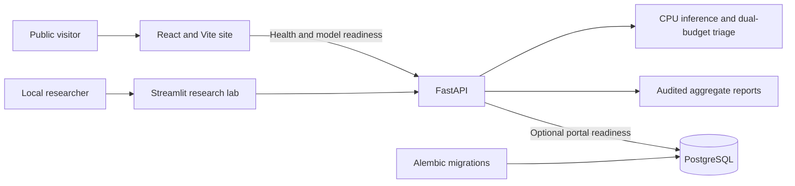

# QSART-X architecture and implementation roadmap

The [QSART-X master development prompt](specifications/QSART_X_MASTER_DEVELOPMENT_PROMPT.md)
governs new platform work. [MASTER_SPEC v1.0](specifications/MASTER_SPEC_v1.0.md)
remains the reference for frozen QSART behavior and historical evidence. The
[backlog](../TASKS.md) tracks work and the [execution log](../PROGRESS.md) records
checks and decisions.

## Architecture

- `apps/web` provides public pages, a static production build, and a teaching
  walkthrough. The Compose proxy exposes two read-only status endpoints. The
  public pages read their evidence summaries and links from source content.
- The existing `api`, `qsart` and `dashboard` packages remain the entry points
  for trained inference, policy, and the research lab. Existing scripts and
  benchmark paths keep their structure. New portal data code lives in
  `services/api/portal_db`.
- `infrastructure/docker/compose.qsart-x.yml` adds the public site, PostgreSQL,
  and a migration service to the existing CPU stack. Database credentials come
  from a local environment file. PostgreSQL has an internal network address and
  a persistent volume. The current portal schema supplies role, user and case
  foundations. Authentication and authorized case workflows belong to Milestone 4.
- Research inputs, model artifacts, and private audit outputs remain in local
  storage. Public pages use a generated retinal illustration and published
  aggregate evidence. The app uses trained artifacts when locally installed.

## Starting inventory

| Area | Available | Milestone gap |
| --- | --- | --- |
| Dataset management | Verified APTOS 2019, DeepDRiD and IDRiD source manifests and historical audits. DeepDRiD Set-C has 99 eligible four-view patients and remains unscored. | Finish import documentation and preserve every held-out boundary. EyeQ source-photo coverage remains incomplete. |
| Inference | Local trained DeepDRiD MobileNetV3 grading and quality models, calibration, conformal sidecar, and APTOS EfficientNet-B0 research checkpoints. CPU image and batch inference verified previously. | Connect an authenticated upload flow and clearly distinguish the EfficientNet reference from the deployed model. |
| Triage and research | Existing three-action engine, separate capacities with explicit overload, recorded stress and external studies, local lab. | Persist human review, compare patient-level risk at matched budgets, and implement real paired-view acquisition evaluation. |
| Dependencies | Windows Python 3.11, Node 24 and Docker Desktop in the development environment. | Install the pinned frontend and optional portal dependencies for the new stack. |

## Milestones

1. **Platform foundation.** Ship the React public site, real service status,
   PostgreSQL migrations, and a verified local Compose stack.
2. **Dataset foundation.** Reuse authenticated manifests, document imports and
   access terms, and make dataset summaries discoverable. Keep the audited Set-C
   eligibility mask fixed.
3. **Connected inference.** Expose the validated local inference path in the
   new interface with genuine artifact and unavailable-state checks. Keep the
   public interface free of case uploads.
4. **Screening and review.** Implement authentication, role enforcement, case
   storage, private image references, review queues, override history and report
   exports. Validate these as one end-to-end workflow.
5. **Research validation.** Lock patient outcomes, models and budgets before
   scoring Set-C. Publish matched-budget, stress and external diagnostics with
   their adverse results and measured scope.
6. **Adaptive acquisition.** Train and test acquisition on true paired eye views
   with patient-disjoint splits. Restrict acquisition decisions to first-view
   information and keep second-view and recapture interpretations distinct.
7. **Research release.** Verify the full stack and authorization behavior in
   Docker, measure resource use, and prepare publication artifacts from audited
   results.

## Retinal illustration

The built-in image generation tool created the [synthetic fundus illustration](../apps/web/public/retina-illustration.webp).
The brief requested a centered orange retinal field, fine branching vessels,
a pale optic disc and a near-black navy surround, without labels or overlays.
The asset is educational and has no associated patient or model predictions.
