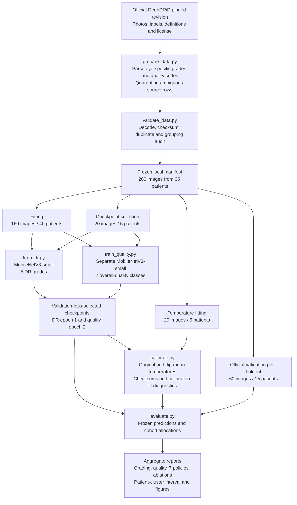

# QSART implemented architecture

This describes the current source and completed real-image pilot, 18 October 2026. Diagrams show implemented paths; they do not imply predictive quality, clinical authorization or verified container deployment.

## Data and training path

Shared preprocessing crops the fundus, letterboxes to a square, converts RGB and applies recorded normalization. The pilot uses 96px and three CPU training epochs from random initialization. Natural defect codes are retained but the current quality checkpoint learns only overall quality. All known views and both eyes of a supplied patient stay together. Final official evaluation data remain untouched. Raw photos, manifests, checkpoints and individual predictions stay local and outside Git.

## Artifact-backed request path

`InferenceEngine` rejects missing, untrained, malformed, nonfinite or software-test artifacts in production loading and checks task, manifest/split provenance and calibration-checkpoint hashes. `/health` reports the API process; `/ready` reports artifact availability. Neither endpoint certifies diagnostic accuracy. The real pilot loads trained artifacts despite poor predictive performance, so the model status and research warning remain essential context.

The selected second pass is horizontal-flip mean logits, not a separate deeper model. Its cap applies to the current request population; the default single-image call receives no extra pass unless explicitly enabled. `/predict` has no population triage-budget guarantee. `/predict/batch` uses the supplied review/recapture capacities and reports their realized action rates; infeasibility is explicit. `AUTO_SCREEN` carries a provisional grade and can be positive. Deferred actions do not imply a completed diagnosis or improved recapture.

## Source map and runtime packaging

| Responsibility | Implemented source |
| --- | --- |
| Metadata and manifest construction | `qsart/deepdrid.py`, `qsart/data/manifests.py`, `scripts/prepare_data.py` |
| Shared pixel transformation | `qsart/preprocessing/fundus.py`, `qsart/training/data.py` |
| Network and checkpoint validation | `qsart/models/networks.py`, `qsart/models/checkpoint.py` |
| Training and calibration | `qsart/training/trainer.py`, `qsart/training/cli.py`, `qsart/calibration/temperature.py` |
| Inference and compute control | `qsart/inference/engine.py` |
| Pointwise and cohort allocation | `qsart/triage.py` |
| Grading, policy and interval reporting | `qsart/evaluation.py`, `scripts/evaluate.py`, `scripts/benchmark_cpu.py` |
| HTTP service and response schema | `api/main.py`, `api/schemas.py` |
| Dashboard | `dashboard/app.py` |
| Container definition | `Dockerfile`, `docker-compose.yml` |

Compose defines separate API and dashboard services using the same image, loopback-bound host ports 8000 and 8501, read-only checkpoint/report mounts and writable temporary filesystems. The dashboard calls the API service. The first image built successfully; latest-source rebuild and real-artifact container checks were pending at this documentation update. Container deployment is unverified until those checks complete.

See [model status](../MODEL_STATUS.md), [data status](../DATA_STATUS.md), [the Review-1 briefing](REVIEW1_BRIEF.md) and the [pilot report](../../reports/pilot/evaluation.json) for measured results and limitations. The held-out DR model predicts grade 3 for all 60 inputs; diagram completeness must not be interpreted as a clinically useful classifier.
