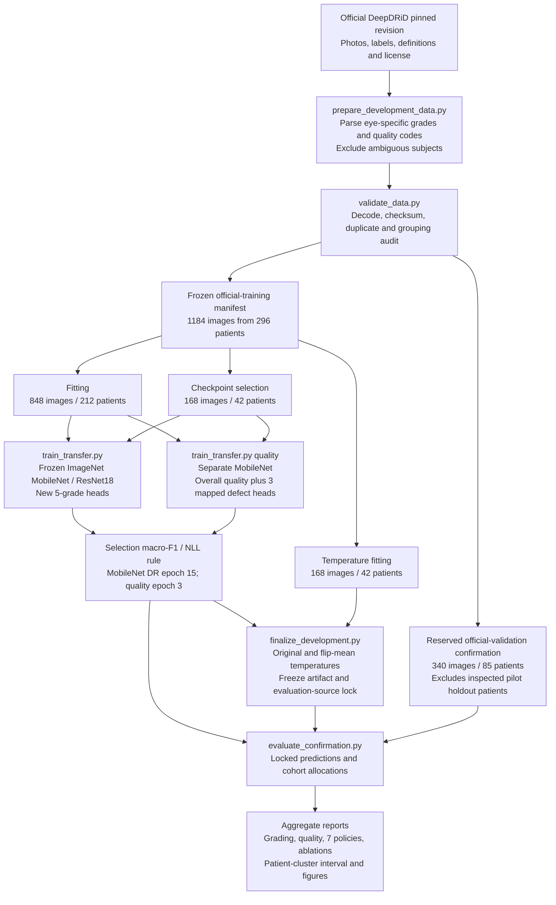
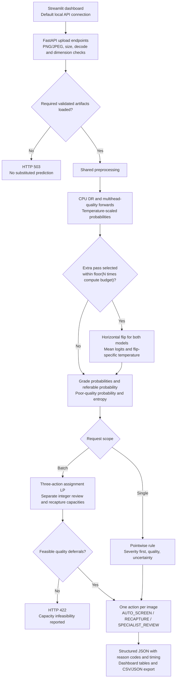

# QSART implemented architecture

This describes the executed development v1 and internal confirmation, 20 October 2026. Original pilot artifacts remain preserved. Diagrams show implemented paths; they do not imply predictive quality, clinical authorization or clinical deployment approval.

## Data and training path

Shared preprocessing crops the fundus, letterboxes to a square, converts RGB and applies recorded normalization. The current models use 224px and frozen ImageNet backbones, including fixed BatchNorm statistics; new heads learn from cached original/flipped fitting views. A fixed statistical logistic quality comparator is fitted separately. Natural defect codes retain reversible mappings. All known views and both eyes of a supplied patient stay together. Final official test data remain untouched. Raw photos, manifests, checkpoints and individual predictions stay local and outside Git.

## Artifact-backed request path

`InferenceEngine` rejects missing, untrained, malformed, nonfinite or software-test artifacts in production loading and checks task, manifest/split provenance and calibration-checkpoint hashes. `/health` reports the API process; `/ready` reports artifact availability. Neither endpoint certifies diagnostic accuracy. The model card appears only when its weights and calibration match the loaded engine. Readiness still does not certify predictive usefulness.

The selected second pass is horizontal-flip mean logits, not a separate deeper model. Its cap applies to the current request population; the default single-image call receives no extra pass unless explicitly enabled. `/predict` has no population triage-budget guarantee. `/predict/batch` uses the supplied review/recapture capacities and reports their realized action rates; infeasibility is explicit. `AUTO_SCREEN` carries a provisional grade and can be positive. Deferred actions do not imply a completed diagnosis or improved recapture.

## Source map and runtime packaging

| Responsibility | Implemented source |
| --- | --- |
| Metadata and manifest construction | `qsart/deepdrid.py`, `qsart/data/manifests.py`, `scripts/prepare_data.py` |
| Shared pixel transformation | `qsart/preprocessing/fundus.py`, `qsart/training/data.py` |
| Network and checkpoint validation | `qsart/models/networks.py`, `qsart/models/checkpoint.py` |
| Training and calibration | `qsart/training/transfer.py`, `qsart/training/trainer.py`, `qsart/calibration/temperature.py` |
| Inference and compute control | `qsart/inference/engine.py` |
| Pointwise and cohort allocation | `qsart/triage.py` |
| Grading, policy and interval reporting | `qsart/evaluation.py`, `qsart/research_statistics.py`, `scripts/evaluate_confirmation.py`, `scripts/benchmark_cpu.py` |
| HTTP service and response schema | `api/main.py`, `api/schemas.py` |
| Dashboard | `dashboard/app.py` |
| Container definition | `Dockerfile`, `docker-compose.yml` |

Compose defines separate API and dashboard services using the same image, configurable loopback-bound host ports (defaults 8000/8501; this workstation uses 18000/18501), read-only checkpoint/report mounts and writable temporary filesystems. The dashboard calls the API service. The rebuilt image and both services are healthy; readiness, real JPEG single/batch/TTA and dashboard checks passed using the current models. Container runtime source matches all 31 local Python files. This verifies local engineering execution, not clinical use.

See [current results](CONFIRMATION_V1_RESULTS.md), [transfer status](../TRANSFER_STATUS.md) and [the Review-1 briefing](REVIEW1_BRIEF.md). Confirmation accuracy is 60.0% for five DR grades and 74.1% for overall quality on 340 same-domain images. Defect heads are weak, and external and prospective validation remain unperformed.
