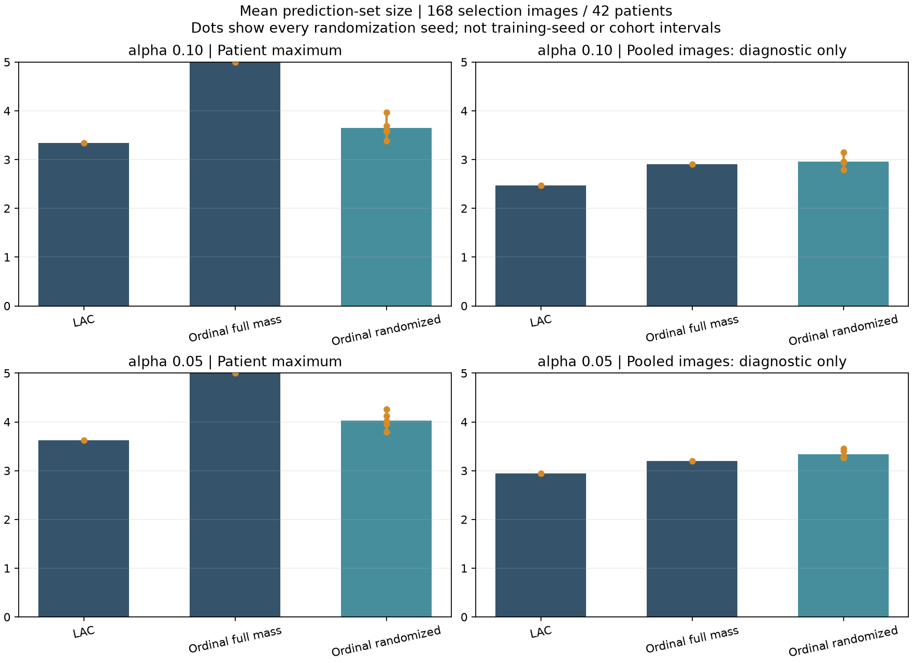
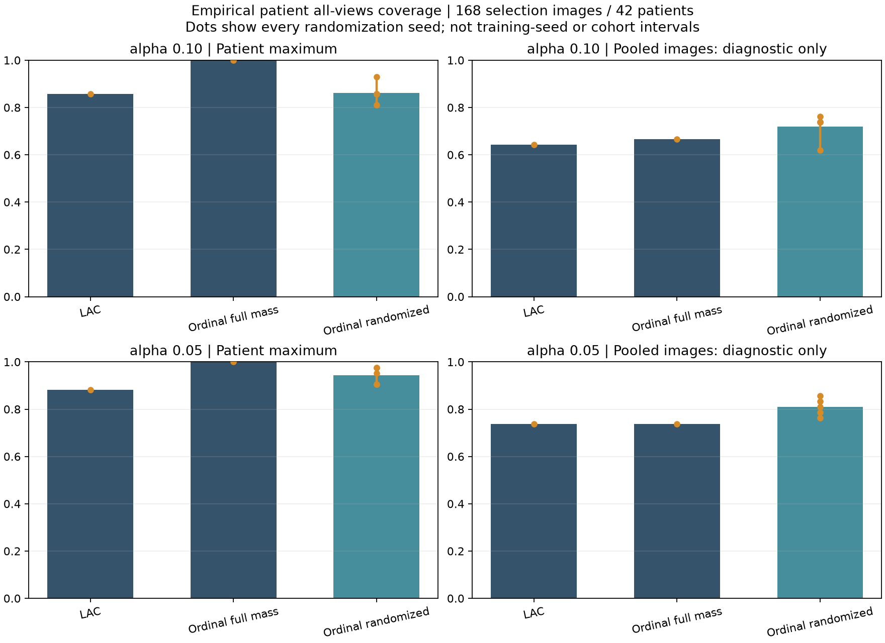

# Ordinal score study — executed 22 October 2026

**VERIFIED COMPLETE:** fixed development diagnostics for ordinal randomization
and calibration units. Useful clinical or operational triage remains unproven.
The original deployed deterministic sidecar remains unchanged.

The [protocol](ORDINAL_STUDY_V1_PROTOCOL.md) was committed as `99a47b5` before new
scores. Execution source was `16bd809d49f8727d5e100410aa835427d12c0999`.
The [aggregate report](../../reports/ordinal_study_v1/evaluation.json) binds exact
source, protocol, packages, input caches and original model/calibration hashes.
Calibration uses the same independent 84 images / 21 patients; evaluation uses
168 selection images / 42 patients. First-pass temperature is reused at its stored
precision, without fitting. All 252 original scored-source image hashes matched.
No confirmation, test or external images were used.

All four historical patient-max baseline fits were reproduced exactly: threshold
error zero and identical selection sets, at both alpha .10 and .05. Among 84
calibration images, three true grades are last in the greedy order, yielding
deterministic score 1. They belong to two patients, so two of the 21 patient
maxima equal 1. The exact rank20/rank21 thresholds are consequently 1, forcing
full five-grade sets. This explains the prior result without altering it.

The new research module supplies one explicit uniform per image, shared across
candidate labels, and uses cumulative mass minus U times candidate probability.
It independently implements the published score randomization; the complete
APTOS training/data experiment is not reproduced. Five fixed randomization seeds
2026–2030 were retained, with no winning seed selection. These are randomization
replicates of one classifier, distinct from the separate training-seed study.

Primary patient-max results (randomized values are mean and observed range across
all five randomization seeds; ranges are not confidence intervals):

| Alpha | Method | Mean set size | Image coverage | Patient all-views coverage |
| --- | --- | --- | --- | --- |
| .10 | LAC |3.345|94.64%|85.71%|
| .10 | Deterministic ordinal |5.000|100.00%|100.00%|
| .10 | Randomized ordinal |3.644 [3.387,3.964]|96.07% [94.05,98.21]|86.19% [80.95,92.86]|
| .05 | LAC |3.625|96.43%|88.10%|
| .05 | Deterministic ordinal |5.000|100.00%|100.00%|
| .05 | Randomized ordinal |4.029 [3.792,4.256]|98.45% [97.02,99.40]|94.29% [90.48,97.62]|

Randomization removes universal full-size sets, but it is not uniformly smaller
than LAC and does not establish the nominal patient-all-views target on this
development population. At alpha .10, randomized patient-max sets are full size
for 17.98% of images on average, versus 100% for deterministic ordinal. Coverage
depends on the calibration unit, population and randomization; image coverage
alone does not answer the simultaneous patient-view question.

The separate pooled-image diagnostic treats 84 correlated images as calibration
units. At alpha .10 randomized mean size is 2.962, image coverage 88.57% and
patient all-views coverage 71.90% across seeds. At alpha .05 these are 3.342,
93.81% and 80.95%. This changes the calibration target and has no justified
iid-image guarantee. Narrower pooled sets cannot be presented as an improvement
on the patient-max guarantee. Every deterministic and randomized row is retained
in the 28-comparison report, including per-grade denominators and raw empty sets.

With the unchanged probability/quality/entropy gates, primary randomized sets
permit only 2–7 automatic non-referable recommendations per 168 images at alpha
.10, and 0–3 at alpha .05. No true-referable automatic case was observed in these
small, already inspected selection subsets. That observation does not establish
safety. Most cases still require review, capacity feasibility is not evaluated
here, and recommendations are not completed care. The production policy still
uses its original deterministic sidecar and retains its all-review limitation.

An independent audit reconstructed all 28 fits and 4,704 final prediction sets
(plus raw sets), coverage/size/guard outcomes and five-seed summaries, using no
project score implementation. Maximum threshold discrepancy was 4.44e-16.
It checked four old baseline fits, 252 original image hashes, split independence,
source/package/cache/artifact bindings and public JSON privacy. Audit evidence is
in reports/ordinal_study_v1/independent_audit.json. It reuses saved raw probabilities
rather than performing a second model-forward run.

These methods were explored after an observed failure, and selection labels also
selected the classifier. Stratified patient sampling and the small independent
calibration population further limit coverage claims. Results are development
diagnostics rather than fresh validation. APS/RAPS, independently tuned policies,
APTOS reproduction and external transport remain separate work.
