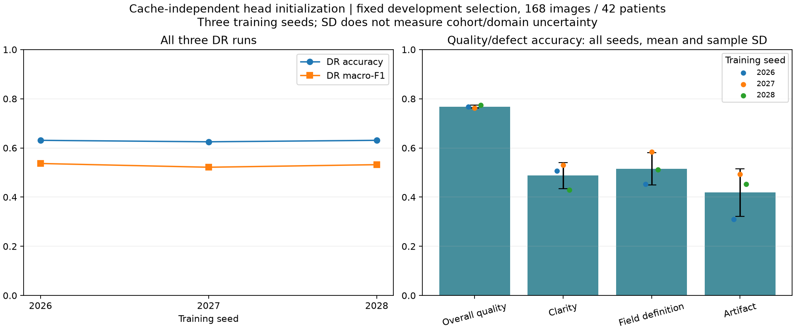

# Repeated training seeds — executed 22 October 2026

**VERIFIED COMPLETE:** all six declared DR/quality development runs. This study
measures training variability after a reproducibility fix; it does not select a
replacement deployment or provide external confirmation.

The [protocol](REPEATED_SEEDS_V1_PROTOCOL.md) was committed as `99a47b5` before
training. All six runs used clean source
`99a6cbbce0204c965c8221d237cf7cf644e57ddf`, the same official ImageNet
MobileNetV3-small backbone and identical newly extracted frozen features. The
[public summary](../../reports/repeated_seeds_v1/summary.json) binds actual input,
config, source, pretrained, feature-cache and checkpoint hashes for every run.
Only 848 fitting images / 212 patients and 168 selection images / 42 patients
were read or predicted. Calibration and confirmation images were not used.

The old trainer initialized heads after feature extraction/loading. Creating a
DataLoader iterator on a cache miss advances Torch RNG state; a cache hit skips
that step. The new procedure explicitly calls torch.manual_seed(config.seed)
immediately before linear-head construction and records
`torch_seed_before_linear_heads_v1`. Software regressions compare cache-miss/hit
model states, complete training histories and saved probabilities for both DR
and all four quality heads; fixed-seed results match exactly. Different seeds
still produce different heads. Existing resume provenance guards reject old
source/cache mismatches; this study does not use resume.

All other configuration values remain fixed: 224px, original+flip training
features, frozen backbone/BatchNorm, weighted cross-entropy, AdamW .01 with
weight decay .0001, batch64, max100 epochs and patience15. Checkpoint selection
uses the existing primary-head macro-F1 then unweighted NLL rule. No temperature
or conformal fitting, condition selection or deployment change occurred.

| Task | Seed | Selected epoch | Executed epochs | Updates | Selection accuracy | Macro-F1 |
| --- | ---: | ---: | ---: | ---: | ---: | ---: |
| DR |2026|15|30|810|63.10%|0.536774|
| DR |2027|24|39|1053|62.50%|0.521493|
| DR |2028|25|40|1080|63.10%|0.531992|
| Overall quality, four-head model |2026|4|19|513|76.79%|0.758541|
| Overall quality, four-head model |2027|10|25|675|76.19%|0.752941|
| Overall quality, four-head model |2028|7|22|594|77.38%|0.757152|

Mean and sample SD across all three seeds:

- DR accuracy **62.90% ±0.34 percentage points**, macro-F1 **0.53009 ±0.00782**,
  QWK **0.73989 ±0.00553**, NLL **1.22393 ±0.02909**.
- Overall-quality accuracy **76.79% ±0.60 percentage points**, macro-F1
  **0.75621 ±0.00292**.
- Natural clarity/field/artifact accuracy **48.81% ±5.29**, **51.59% ±6.56** and
  **41.87% ±9.68 percentage points**, respectively. Defect heads remain weak or
  unstable; artifact accuracies are 30.95%, 49.40% and 45.24%.

An independent audit additionally computed training-majority constant predictors
as a diagnostic: field-definition selection accuracy is 69.05% and artifact
47.62%, above the corresponding model means. These post-run audit comparators
are not newly tuned policies. Field-definition class0 has just three fitting and
one selection example; other rare defect classes also limit interpretation.

These are sample SDs of training-seed variation on one fixed selection population,
not confidence intervals, cohort uncertainty or proof of improvement. The JSON
retains all requested DR calibration/risk metrics, uncalibrated first-pass
probabilities' metric definitions, every head's results and actual class supports.
Referable sensitivity uses argmax grade>=2, matching the historical comparison.

Historical seed2026 belongs to the previous initialization procedure and is
excluded from this three-seed summary. It remains a genuine recorded measurement;
no old artifact or metric is overwritten. The legacy trainer's model_version
string may collide between old/new seed/epoch labels. Experiment ID,
head_rng_version, source and checkpoint SHA256 jointly identify these new runs;
the version string alone is not sufficient. Selected deployed DR/quality weights,
calibration, model card and conformal sidecar remain unchanged.

The fresh feature extraction took 119.08 seconds; all subsequent runs used that
same cache. Individual execution times include hashing/cache operations and normal
workstation load. They are not matched architecture or deployment benchmarks.
Source-provenance dirty flags are false for every run. Private weights, cache,
logs and individual predictions remain local and ignored.

Independent verification recomputed all six runs' saved metrics, labels, class
supports and 21 mean/sample-SD outcomes; checked 48 recorded run-file hashes,
source/config/input/cache bindings, and original selected artifact preservation.
Direct linear-head multiplication of saved features reproduced probabilities
within 1.63e-7. Saved best/last backbone tensors matched official weights. This
uses saved execution evidence rather than OS-level image-I/O tracing or another
retinal model-forward run. See reports/repeated_seeds_v1/independent_audit.json.



The executed command used the frozen checkout above:

```powershell
.\.venv\Scripts\python.exe scripts/run_repeated_seeds.py --execute --protocol docs/research/REPEATED_SEEDS_V1_PROTOCOL.md --source-commit 99a6cbbce0204c965c8221d237cf7cf644e57ddf
```

The runner requires that exact source revision and refuses existing run outputs.
Preserve this execution rather than rerunning over it. A new scientific run needs
its own declared output design. Independent external evaluation and prospective
utility remain outstanding, and formal manuscript drafting remains deferred.
