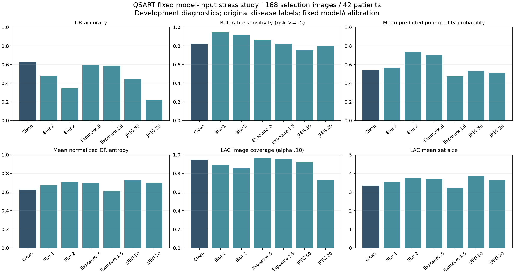
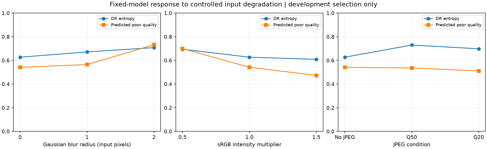
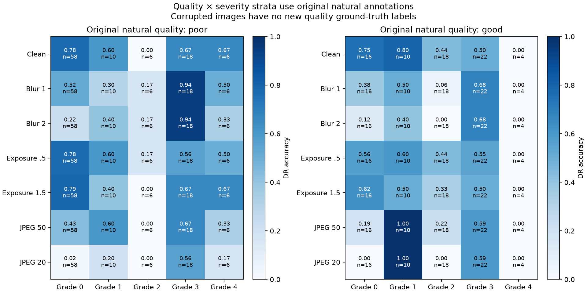

# Controlled model-input degradation — executed 22 October 2026

**VERIFIED COMPLETE:** the fixed synthetic-degradation development study.
Overall QSART research remains **IN PROGRESS**. The measured responses expose
substantial compression/blur vulnerability and an unreliable quality-score
response to compression. They do not demonstrate useful automatic triage.

The [protocol](ROBUSTNESS_V1_PROTOCOL.md) was committed as `8c0c83b` before scores
were generated. Execution source was
`493ad7c6e37d16dc338e00280d8ac714ee23a0c8`; the
[aggregate report](../../reports/robustness_v1/evaluation.json) binds exact
protocol, source, manifest, checkpoint, calibration, package and private-cache
hashes. Individual outputs and RGB hashes stay in ignored local artifacts.

All seven fixed conditions were evaluated on the same 168 genuine selection
images / 42 patients. Original bytes were verified. Each image was cropped and
letterboxed/resized once to 224px, then independently perturbed and directly
normalized. Clean scores matched ordinary inference **exactly** for all 168
images, including DR, overall quality, three defect heads and raw DR scores.
No model, temperature, conformal threshold, action gate or condition was tuned.
Inference used only the first pass. The scored population excludes confirmation,
official test and external IDRiD data. Execution plus descriptive bootstrap
calculations took 95.65 seconds; this is not an inference deployment benchmark.

| Condition | DR accuracy | Macro-F1 | Referable sensitivity | Specificity | Mean poor-quality score | LAC image coverage | LAC mean size |
| --- | ---: | ---: | ---: | ---: | ---: | ---: | ---: |
| Clean |63.10%|0.5372|82.43%|82.98%|0.541|94.64%|3.345|
| Blur radius 1 |48.21%|0.3749|94.59%|47.87%|0.565|88.69%|3.548|
| Blur radius 2 |34.52%|0.2664|91.89%|24.47%|0.732|85.71%|3.744|
| Intensity ×0.5 |59.52%|0.4925|86.49%|76.60%|0.699|96.43%|3.702|
| Intensity ×1.5 |58.33%|0.4856|82.43%|77.66%|0.473|95.24%|3.244|
| JPEG quality 50 |44.64%|0.3784|75.68%|69.15%|0.536|91.67%|3.839|
| JPEG quality 20 |22.02%|0.1520|79.73%|37.23%|0.511|73.21%|3.637|

Referability here is original grade >=2, with predicted risk sum P(grade>=2) >=0.5;
there are 74 positive images from 21 patients and 94 negative images. This differs
from the argmax-grade sensitivity in the model-comparison table. Increased blur
sensitivity accompanies a large specificity loss; it is not better screening.
Raw classifier false negatives are 13 clean, 4/6 under blur, 10/13 under intensity
changes and 18/15 under JPEG 50/20. These are classifier errors, not automatic
clearance misses: current conformal-guarded pointwise routing recommends review
for all 168 images in every condition.

Paired patient-cluster bootstrap changes from clean, 1,000 resamples, seed
20261022, descriptive 95% percentile intervals:

| Condition | Accuracy change, percentage points | Interval |
| --- | ---: | --- |
| Blur radius 1 |-14.88|[-24.40, -4.17]|
| Blur radius 2 |-28.57|[-40.49, -14.88]|
| Intensity ×0.5 |-3.57|[-8.93, +1.19]|
| Intensity ×1.5 |-4.76|[-8.93, -0.60]|
| JPEG quality 50 |-18.45|[-26.79, -9.52]|
| JPEG quality 20 |-41.07|[-53.59, -26.79]|

No multiplicity adjustment, significance test or superiority claim is made.
All original views of a sampled patient remain paired. The JSON contains paired
intervals for NLL, entropy, poor-quality probability, LAC coverage/set size and
referable sensitivity as well as accuracy.

The quality model responds to stronger blur and darkening with higher poor-quality
probability. It does not respond monotonically across defect types. Under JPEG20,
mean poor-quality probability changes by -0.0304, descriptive interval
[-0.0609,+0.0025], while accuracy falls sharply. Entropy rises from 0.6268 clean
to 0.7294 at JPEG50, then falls to 0.6978 at JPEG20 despite worse accuracy.
Brightening lowers both mean poor-quality score and entropy while accuracy also
falls. Neither score is a reliable stand-alone indicator of every synthetic
degradation's effect on disease grading.

Fixed LAC coverage at alpha .10 falls to 73.21% for JPEG20, and patient all-views
coverage falls from 85.71% to 45.24%. Its image-coverage change is -21.43 percentage
points, descriptive interval [-29.17,-14.29]. The ordinal sets remain all five
grades in every condition, giving 100% coverage without resolving disease grade.
Shifted-data guarantees or benefit from universal specialist review are not
claimed. Capacity feasibility and real recapture/review outcomes are not evaluated
by these pointwise action counts.

The original natural-quality annotations contain 98 poor and 70 good source
images. Clean quality classification accuracy is 74.40%; the quality-by-severity
heatmap reports all original stratum counts, including small grade-4 cells. These
annotations provide context for transformed images, not new defect ground truth.
No corrupted-image quality accuracy is reported. Original disease labels describe
underlying disease, although corruption can hide visible diagnostic evidence.







These 224px sRGB perturbations are not physical camera exposure, a complete
distribution-shift evaluation, or external validation. JPEG after resizing differs
from source-image compression. Development selection informed model choice, and
one seed/model is studied. Independent model improvements, useful ordinal sets,
policy comparator tuning, repeated training seeds and fresh external evaluation
remain required. APTOS training still awaits the official dataset; this study does
not replace it.

To reproduce from the preserved models/data:

```powershell
.\.venv\Scripts\python.exe scripts/run_controlled_degradation.py
```

The runner refuses existing experiment directories. Keep the current artifacts;
use fresh `--output reports/...` and `--private artifacts/...` directories for a
new execution with an explicitly recorded protocol. Source/package/hash bindings
and exact counts must be checked before comparing executions.
